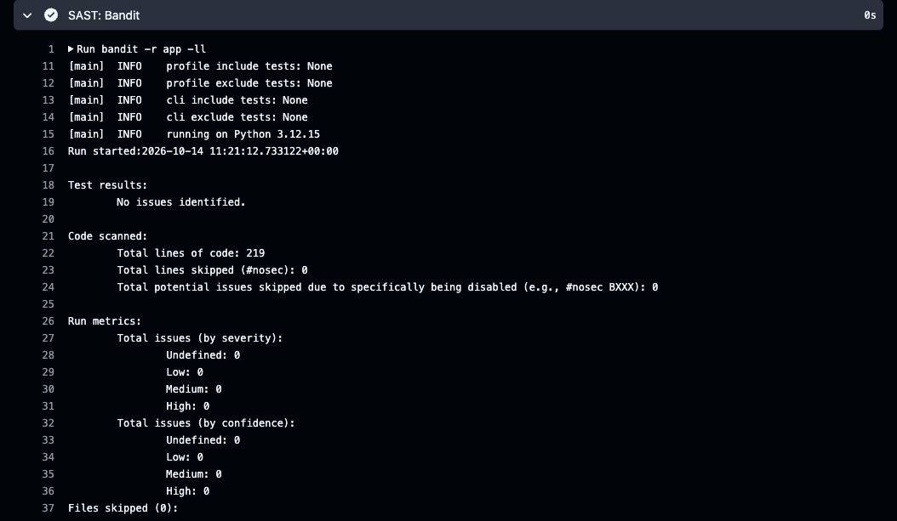
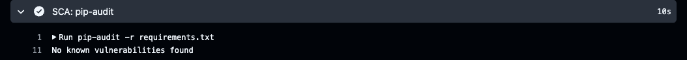
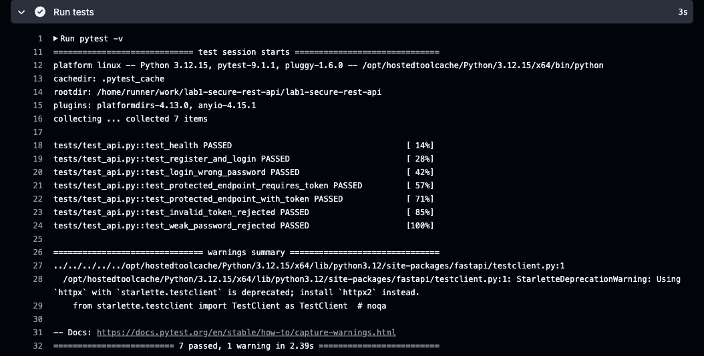
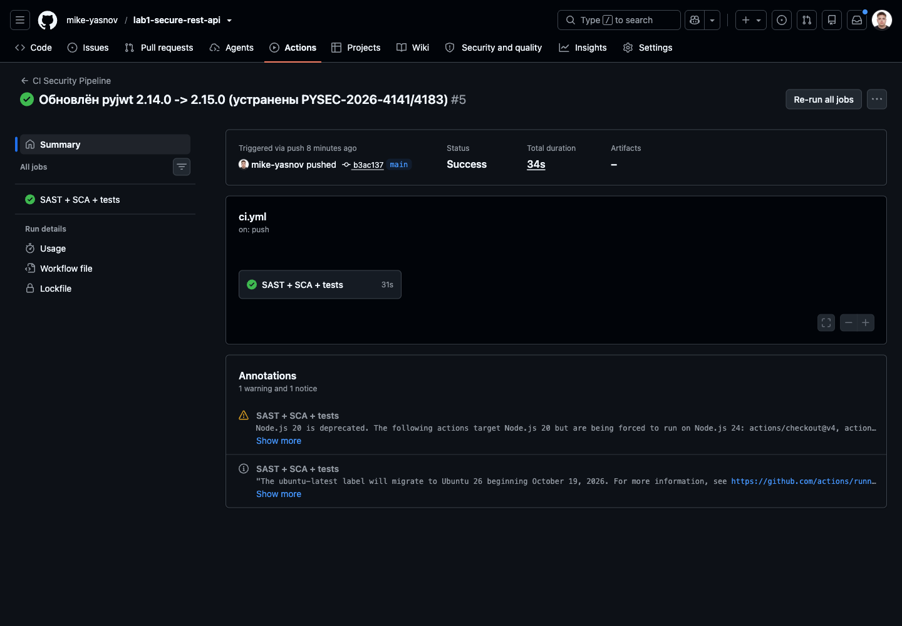

# Информационная безопасность

## Лабораторная работа №1

«Разработка защищённого REST API с интеграцией в CI/CD»

### Стек

- Python 3.12 / FastAPI
- SQLAlchemy + SQLite
- JWT (PyJWT), bcrypt
- pytest, Bandit (SAST), pip-audit (SCA)
- GitHub Actions

### Описание API

`POST /auth/register`: регистрация пользователя (принимает логин и пароль).
```json
{
  "username": "mike",
  "password": "S3curePass!"
}
```

`POST /auth/login`: аутентификация пользователя, возвращает JWT-токен.
```json
{
  "username": "mike",
  "password": "S3curePass!"
}
```

`GET /api/data`: получение списка постов. Доступ только у аутентифицированных
пользователей (заголовок `Authorization: Bearer <token>`).

`POST /api/posts`: создание поста. Доступ только у аутентифицированных пользователей.
```json
{
  "title": "Заголовок",
  "content": "Текст поста"
}
```

### Описание реализованных мер защиты

- От **SQLi** код защищён с помощью ORM SQLAlchemy: запросы параметризуются,
  конкатенации строк в SQL нет. Логин дополнительно валидируется по `[A-Za-z0-9_]`.

```python
db.query(User).filter(User.username == payload.username).first()
```

- От **XSS** код защищён экранированием пользовательских данных (`html.escape`)
  перед сохранением и выдачей.

```python
Post(title=sanitize(payload.title), content=sanitize(payload.content))
```

- От **Broken Authentication**: пароли хранятся bcrypt-хэшем со случайной добавкой,
  уникальной для каждого пароля; вход выдаёт подписанный JWT (HS256, срок жизни
  30 минут); защищённые эндпоинты проверяет middleware `get_current_user`; секрет
  подписи берётся из переменной окружения `SECRET_KEY`.

```python
password_hash = bcrypt.hashpw(password.encode(), bcrypt.gensalt())
token = jwt.encode(payload, SECRET_KEY, algorithm="HS256")
```

### Отчёты из pipeline

Конфиг конвейера — [.github/workflows/ci.yml](.github/workflows/ci.yml). Запускается
на каждый push и pull request: Bandit (SAST), pip-audit (SCA), pytest.

Bandit (SAST), уязвимостей не найдено:



pip-audit (SCA), уязвимых зависимостей не найдено:



pytest, все тесты пройдены:



Обзор прогона в разделе Actions, статус Success:



### Последний запуск пайплайна

https://github.com/mike-yasnov/lab1-secure-rest-api/actions/runs/35115503803
